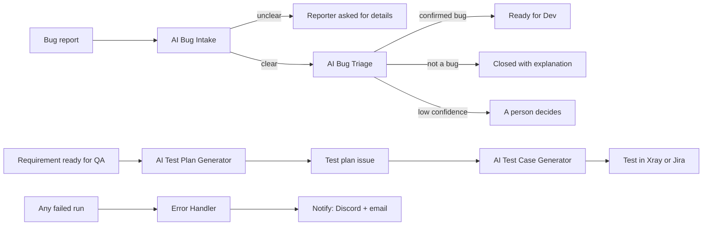

# n8n QA Workflows

n8n workflows that put an LLM into the QA process (bug intake, bug triage, test plans and test cases) and check the model's output with code before anything reaches Jira.

Each one is generalised from a workflow I built and ran in production as a QA manager at an online-education company (2025–2026). Together, the originals replaced about **230 hours of manual QA work a month**.

| Workflow | What it does | Manual work it replaced |
|---|---|---|
| [AI Bug Intake – Ask Reporter For Missing Info](ai-bug-intake-ask-for-missing-info/) | Checks each new bug report and asks the reporter for exactly what is missing | Together with triage: ~150 reports/month × ~45 min ≈ **110 h/month** |
| [AI Bug Triage – Escalate To Dev](ai-bug-triage-escalate-to-dev/) | Bug or not, open questions, field extraction with validated values, hand-off to developers | (counted above) |
| [AI Test Plan Generator – Jira](ai-test-plan-generator/) | Writes a reviewed software test plan for each requirement ready for QA | ~40 plans/month × ~2 h ≈ **80 h/month** |
| [AI Test Case Generator – Jira + Xray](ai-test-case-generator-xray/) | Writes an end-to-end test case per plan; code check, AI review and fix loop before it is created | ~40 tests/month × ~1 h ≈ **40 h/month** |
| [Notify – Discord + Email](notify-discord-email/) | Reusable alert sub-workflow | – |
| [Error Handler – Alert On Failed Workflows](error-handler-alert-on-failure/) | Alerts on any failed workflow, including trigger failures | – |

Each folder has the workflow JSON, a canvas screenshot, what it does, what it replaced, and setup steps.

## How they fit together

## How the AI output is kept in check

- **Code validates every model answer** before it touches Jira: JSON shape, allowed values, single-line fields, table columns, section coverage. An answer that fails validation is never guessed at.
- **Confidence gate.** Triage acts on its own decision only above a confidence threshold. Below it, the ticket gets a note and the `ai-needs-human` label.
- **Write → check → review → fix.** The test case generator checks the table with code first, then has a second model review it, and sends the exact problems back to the writer. A test is created only after it passes.
- **Idempotent.** Labels mark every ticket a workflow has handled, and the JQL filters skip them, so nothing is processed twice.
- **Statuses by name.** Workflows move tickets by the status name on your board, not by transition IDs, and fail with a message listing the reachable statuses when a name is wrong.
- **Failures are loud.** A run that can't finish is marked failed, and the error handler sends the details to Discord and email.

## Setup in short

1. Import a workflow JSON into n8n (**⋯ → Import from File**).
2. Create your credentials once: *Jira Software Cloud API* (email, API token, domain) and *OpenAI*. Selecting a credential on one node applies it to the matching nodes in that workflow.
3. Edit the **⚙️ Config** node: every setting that depends on your Jira lives there.
4. Try it on one ticket with `testIssueKey` and **Test workflow**, then activate it (n8n 2.x: publish).

The setup section in each folder lists every Config key.

## Requirements

- n8n with built-in nodes only, no community nodes. Built and tested on n8n 2.35.7.
- Jira Cloud (REST API v2 and v3). Xray Cloud is optional.
- OpenAI API (the "Message a model" node). The text-parsing helper in each Code node also reads the output of other model nodes, so switching providers means replacing the model nodes, not rewriting the logic.

## How they were tested

Every workflow was imported into n8n 2.35.7 and run end to end against mock Jira, OpenAI, Xray, Discord and SMTP servers that reject malformed requests: 84 checks covering every branch. These include a clear bug, an unclear bug, unusable model output, low confidence, an unreachable status, a field that isn't on the edit screen, a test case that passes after a fix, one that never passes, and both Xray and Jira-only modes.

## Author

Jonathan Davis: SDET and AI automation engineer. I build AI-powered automation and test it like production code.
[LinkedIn](https://linkedin.com/in/jonathanda)
