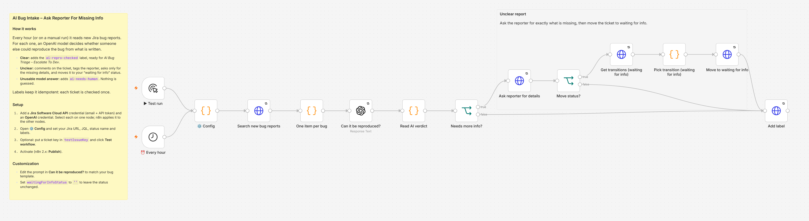

# AI Bug Intake – Ask Reporter For Missing Info

Reads new Jira bug reports, decides with an LLM whether each one can be reproduced, and asks the reporter for exactly what is missing.

## What it does

- Runs every hour (or on a manual test run) and fetches up to 10 bug reports that match your JQL and have not been checked yet.
- Sends each report to an OpenAI model with one question: could someone else reproduce this bug from what is written?
- **Clear report:** adds the label `ai-repro-checked`. The next workflow, [AI Bug Triage – Escalate To Dev](../ai-bug-triage-escalate-to-dev/), picks it up from there.
- **Unclear report:** posts a comment that tags the reporter and lists only the missing details (steps, expected and actual result, environment, affected account, frequency, screenshot), then moves the ticket to your "waiting for info" status.
- **Model answer that is not the agreed JSON:** adds `ai-needs-human` and does nothing else. The workflow never guesses.

Each ticket is checked once: the labels are part of the JQL filter.

## What it replaced

In production this workflow and [AI Bug Triage](../ai-bug-triage-escalate-to-dev/) handled about **150 bug reports a month**. Before them, a QA engineer spent about **45 minutes per report** reading it, writing to the reporter for missing details, filling the bug fields and routing it to developers.

**Hours saved (both bug workflows together): about 110 hours a month** (150 × 45 min).

This version is generalised from that production workflow: everything specific to the original company was removed and moved into one settings node.

## Setup

### You need

- n8n with built-in nodes only. Built and tested on n8n 2.35.7.
- Jira Cloud and a Jira API token for a user who can browse the project, add comments, edit issues and transition issues.
- An OpenAI API key.

### Steps

Shortcut: create the credentials before you import and name them exactly `Jira Cloud account` and `OpenAI account`. n8n then links them to every node when you save the imported workflow.

1. **Import.** In n8n, create a new workflow, then use **⋯ → Import from File** and pick `ai-bug-intake-ask-for-missing-info.json` (or paste the file's content onto the canvas).
2. **Jira credential.** Create an API token at <https://id.atlassian.com/manage-profile/security/api-tokens>. In n8n, open the **Search new bug reports** node, choose **Create new credential** of type *Jira Software Cloud API*, and fill in:
   - Email: your Atlassian account email
   - API Token: the token
   - Domain: `https://your-company.atlassian.net`

   n8n then applies the credential to every other Jira node in the workflow.
3. **OpenAI credential.** Open **Can it be reproduced?** and create an *OpenAI* credential with your API key.
4. **Settings.** Open **⚙️ Config** and edit the values (table below).
5. **Jira check.** The status in `waitingForInfoStatus` must exist and be reachable from the status your JQL picks up. If it isn't, the run fails with a message that lists the statuses that are reachable.
6. **Test on one ticket.** In **⚙️ Config**, set `const testIssueKey = 'BUG-123';` (a real unclear bug), click **Test workflow**, and check the ticket in Jira: a comment that tags the reporter, the new status, and the `ai-repro-checked` label. Set `testIssueKey` back to `''`.
7. **Turn it on.** Activate the workflow (n8n 2.x: **Publish**). Optional: set **Settings → Error workflow** to [Error Handler – Alert On Failed Workflows](../error-handler-alert-on-failure/).

### ⚙️ Config

| Key | What to set | Default |
|---|---|---|
| `jiraBaseUrl` | Your Jira Cloud site; must match the credential's Domain | `https://your-company.atlassian.net` |
| `jql` | Which bug reports to check. Keep the label filter at the end | `project = BUG AND issuetype = Bug AND status = "Triage" AND (labels is EMPTY OR labels not in (ai-repro-checked, ai-needs-human)) ORDER BY created ASC` |
| `maxIssuesPerRun` | Tickets per run | `10` |
| `requesterField` | Who gets tagged: `reporter`, or a user-picker custom field id such as `customfield_10050` when a service account files tickets for other people | `reporter` |
| `waitingForInfoStatus` | Status name for unclear bugs, as shown on your board. `''` leaves the status unchanged | `Waiting for info` |
| `labels.checked` | Label added to every checked ticket | `ai-repro-checked` |
| `labels.needsHuman` | Label added when the model's answer was unusable | `ai-needs-human` |
| `model` | OpenAI model id | `gpt-5.4-mini` |
| `testIssueKey` | One ticket for a manual test run; ignored on scheduled runs | `''` |

## Behaviour and limits

- One model call per ticket.
- The comment uses Jira wiki markup and an `[~accountid:…]` mention, so the reporter gets a notification.
- The model sees the summary and description only, not attachments or comments.
- To check a ticket again (for example after the reporter edited it), remove its `ai-repro-checked` label.
