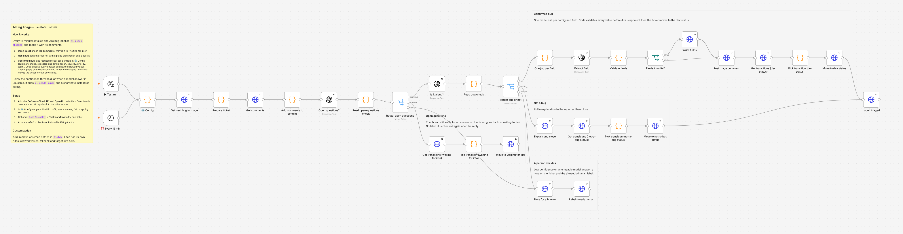

# AI Bug Triage – Escalate To Dev

Takes one checked bug report at a time, decides whether it is ready, whether it is really a bug, and, if it is, fills the bug fields and hands it to developers. Every model answer is validated by code before Jira is touched.

## What it does

Every 15 minutes it takes the next Jira bug labelled `ai-repro-checked` (set by [AI Bug Intake](../ai-bug-intake-ask-for-missing-info/)) and reads it together with its comments.

1. **Open questions?** A model checks whether the newest comments still wait for an answer. If yes, the ticket moves to "waiting for info". No label is added, so it is checked again after the reply.
2. **Is it a bug?** A model classifies it and returns a confidence score. If it is not a bug, the workflow tags the reporter with a short, polite explanation and moves the ticket to your "not a bug" status.
3. **Confirmed bug:** one focused model call per field listed in **⚙️ Config** (summary, steps to reproduce, expected and actual result, environment, setup, affected user, URL, reproduction rate, severity, priority, owning team). Code then checks every answer:
   - one line where one line is required
   - only allowed values (for example, a priority the model invents falls back to `Medium`)
   - `UNKNOWN` answers use the field's fallback or are left empty
4. It posts one triage comment with all values, writes the fields you mapped to Jira, moves the ticket to your dev status and adds `ai-triaged`.

**When it doesn't act:** confidence below `confidenceThreshold` (default 70), or a model answer that isn't the agreed JSON. The ticket gets a short note and the `ai-needs-human` label instead.

## What it replaced

In production this workflow and [AI Bug Intake](../ai-bug-intake-ask-for-missing-info/) handled about **150 bug reports a month**. Before them, a QA engineer spent about **45 minutes per report**: reading the report and its comments, deciding whether it was a bug, rewriting the summary to the team's format, filling severity, priority and the reproduction fields, and routing it to the right developers.

**Hours saved (both bug workflows together): about 110 hours a month** (150 × 45 min).

This version is generalised from that production workflow: the company's fields, statuses and teams were replaced by one settings node with a field list you edit.

## Setup

### You need

- n8n with built-in nodes only. Built and tested on n8n 2.35.7.
- Jira Cloud and a Jira API token for a user who can browse the project, add comments, edit issues and transition issues.
- An OpenAI API key.

### Steps

Shortcut: create the credentials before you import and name them exactly `Jira Cloud account` and `OpenAI account`. n8n then links them to every node when you save the imported workflow.

1. **Import.** In n8n, create a new workflow, then **⋯ → Import from File** and pick `ai-bug-triage-escalate-to-dev.json`.
2. **Jira credential.** Create an API token at <https://id.atlassian.com/manage-profile/security/api-tokens>. Open **Get next bug to triage**, create a *Jira Software Cloud API* credential (Email, API Token, Domain `https://your-company.atlassian.net`). n8n applies it to every other Jira node.
3. **OpenAI credential.** Open **Open questions?** and create an *OpenAI* credential. n8n applies it to the other OpenAI nodes.
4. **Settings.** Edit **⚙️ Config** (tables below). Replace the example teams in the `team` field with your own.
5. **Jira check.**
   - The three statuses in `statuses` must exist and be reachable from the status your JQL picks up.
   - Every field you map with `target` must be on the issue's edit screen. If it isn't, Jira rejects the update and the run fails. Add the field to the screen, or set its `target` to `''`.
6. **Test on one ticket.** Set `const testIssueKey = 'BUG-123';` in **⚙️ Config**, click **Test workflow**, and check the ticket: triage comment, updated summary and priority, new status, `ai-triaged` label. Set `testIssueKey` back to `''`.
7. **Turn it on.** Activate the workflow (n8n 2.x: **Publish**). Optional: **Settings → Error workflow → [Error Handler – Alert On Failed Workflows](../error-handler-alert-on-failure/)**.

### ⚙️ Config: main settings

| Key | What to set | Default |
|---|---|---|
| `jiraBaseUrl` | Your Jira Cloud site; must match the credential's Domain | `https://your-company.atlassian.net` |
| `jql` | Bugs to triage. Keep the label filters | `project = BUG AND issuetype = Bug AND status = "Triage" AND labels = ai-repro-checked AND labels not in (ai-triaged, ai-needs-human) ORDER BY created ASC` |
| `requesterField` | Who gets tagged in the closing comment: `reporter` or a user-picker custom field id | `reporter` |
| `confidenceThreshold` | 0 to 100. Below it, a person decides | `70` |
| `statuses.waitingForInfo` | Status when comments have open questions | `Waiting for info` |
| `statuses.notABug` | Status for tickets that are not bugs | `Closed` |
| `statuses.escalated` | Status for confirmed bugs | `Ready for Dev` |
| `labels.triaged` | Label added when triage finished | `ai-triaged` |
| `labels.needsHuman` | Label added when a person must decide | `ai-needs-human` |
| `models.fast` | Model for the two checks and one-line fields | `gpt-5.4-mini` |
| `models.smart` | Model for steps to reproduce | `gpt-5.5` |
| `testIssueKey` | One ticket for a manual test run | `''` |

### ⚙️ Config: fields

Each entry in `fields` is one model call. Values always go into the triage comment; `target` decides where else they are written.

| `target` value | Written to |
|---|---|
| `''` | Comment only |
| `summary` | The issue summary |
| `priority` | The priority field. Allowed values must match your priority names |
| `components` | The Components field. Allowed values must match component names |
| `customfield_10050` (example) | A custom field. Add `fieldType: 'option'` for select lists. Find the id in Jira: Settings → Issues → Custom fields → ⋯ → Edit; it is in the URL |

Other keys per field: `rules` (instructions for that field), `allowed` (list of `{ value, meaning }`), `fallback` (value when the ticket doesn't say), `multiline`, `model` (`fast` or `smart`), `enabled: false` to skip it.

Defaults:

| Field | Default target | Allowed values | Fallback |
|---|---|---|---|
| Summary | `summary` | any, format `[Environment] - [Area] - [Defect + trigger]` | none |
| Steps to reproduce | comment only | any, numbered steps | none |
| Expected result | comment only | any | none |
| Actual result | comment only | any | none |
| Environment | comment only | Production, Staging | none |
| Setup | comment only | any, `OS \| Browser \| Device` | none |
| Affected user | comment only | any | none |
| URL | comment only | any | none |
| Reproduction rate | comment only | any, as stated in the ticket | none |
| Severity | comment only | Critical, High, Medium, Low | Medium |
| Priority | `priority` | Highest, High, Medium, Low | Medium |
| Owning team | comment only | Web, Mobile, Backend (examples: replace) | none |

## Behaviour and limits

- One ticket per run, so each execution log is easy to read. Raise the schedule frequency for more throughput.
- Model calls per confirmed bug: 2 checks + 1 per enabled field (14 with the defaults). A ticket stopped at step 1 or 2 costs 1 or 2 calls.
- The original description is never overwritten. Only mapped fields change.
- Re-triage a ticket by removing its `ai-triaged` or `ai-needs-human` label.
