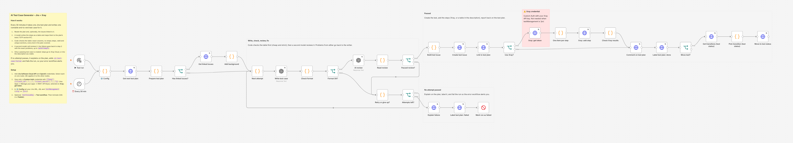

# AI Test Case Generator – Jira + Xray

Writes one runnable end-to-end test case for each Jira test plan. Code checks the table, a second model reviews it, and failures go back with the exact problems. The test is created in Jira (and Xray) only after it passes.



## What it does

Every 30 minutes it takes one test plan that matches your JQL and has no test case yet.

1. **Read.** The plan's description and, optionally, up to 5 issues linked to it (for example the original requirement) as background.
2. **Write.** A model writes the test case as a table: `Step # | Action | Data (optional) | Expected Result | STP Section`. If the plan has a "Test Name" coverage table (as made by [AI Test Plan Generator](../ai-test-plan-generator/)), each of its tests is "STP section N" and must be covered.
3. **Check with code.** Exact columns, no empty actions or expected results, `STP section N` format, no section used twice, every section of the plan covered, no leftover `Assumption:` text. A table that fails here goes straight back to step 2 without spending a review call.
4. **Review with AI.** A second model call answers PASS, or FAIL with a list of fixes.
5. **Fix loop.** Anything that failed returns to step 2 with the exact problems, up to `maxAttempts` attempts.
6. **Create.** Only a passing test case is created: a Test issue linked to the plan, with the steps added to Xray Cloud through its GraphQL API, or written as a table in the description when you don't use Xray.
7. **Report back.** A comment on the plan with the link and the attempt that passed, and the `ai-test-case-created` label.

If no attempt passes, nothing is created. The plan gets a comment with the last problems found and the `ai-test-case-failed` label, and the run is marked as failed so your error workflow alerts you.

## What it replaced

In production this workflow wrote a test case for about **40 test plans a month**. Each one took a QA engineer about **1 hour** to write and enter in Xray by hand.

**Hours saved: about 40 hours a month** (40 × 1 h).

This version is generalised from that production workflow. The Xray key lives in an n8n credential, never in the workflow file.

## Setup

### You need

- n8n with built-in nodes only. Built and tested on n8n 2.35.7.
- Jira Cloud and a Jira API token for a user who can browse the projects, create and link issues, add comments and edit issues.
- An OpenAI API key.
- With Xray: Xray Cloud and an Xray API key (client id and secret). Without Xray: set `testManagement` to `'jira'`.

### Steps

Shortcut: create the credentials before you import and name them exactly `Jira Cloud account` and `OpenAI account`. n8n then links them to every node when you save the imported workflow.

1. **Import.** In n8n, create a new workflow, then **⋯ → Import from File** and pick `ai-test-case-generator-xray.json`.
2. **Jira credential.** Create an API token at <https://id.atlassian.com/manage-profile/security/api-tokens>. Open **Get next test plan**, create a *Jira Software Cloud API* credential (Email, API Token, Domain `https://your-company.atlassian.net`). n8n applies it to every other Jira node.
3. **OpenAI credential.** Open **Write test case** and create an *OpenAI* credential. n8n applies it to **AI review**.
4. **Xray credential (Xray only).** As a Jira admin: **Apps → Manage your apps → XRAY: API Keys → Create API Key**, pick the user, **Generate**, and copy the Client Id and Client Secret. In n8n, open **Xray: get token**, create a *Custom Auth* credential and paste this as its JSON, with your values:

   ```json
   {"body": {"client_id": "YOUR_CLIENT_ID", "client_secret": "YOUR_CLIENT_SECRET"}}
   ```

5. **Settings.** Edit **⚙️ Config** (table below). For Xray Cloud with EU data residency, set `xrayBaseUrl` to `https://eu.xray.cloud.getxray.app`.
6. **Test on one plan.** Set `const testIssueKey = 'QA-123';`, click **Test workflow**, and check Jira: a new Test issue with its steps, linked to the plan, and a comment and label on the plan. Set `testIssueKey` back to `''`.
7. **Turn it on.** Activate the workflow (n8n 2.x: **Publish**) and set **Settings → Error workflow → [Error Handler – Alert On Failed Workflows](../error-handler-alert-on-failure/)**, so a plan that fails every attempt reaches you.

### ⚙️ Config

| Key | What to set | Default |
|---|---|---|
| `jiraBaseUrl` | Your Jira Cloud site; must match the credential's Domain | `https://your-company.atlassian.net` |
| `jql` | Test plans to process. Keep the label filter | `project = QA AND issuetype = "Test Plan" AND status = Done AND (labels is EMPTY OR labels not in (ai-test-case-created, ai-test-case-failed)) ORDER BY updated ASC` |
| `testManagement` | `xray`: steps go to Xray Cloud. `jira`: steps go into the description as a table | `xray` |
| `xrayBaseUrl` | Xray Cloud API address | `https://xray.cloud.getxray.app` |
| `test.projectKey` | Project for the new Test issues | `QA` |
| `test.issueType` | Issue type: `Test` with Xray, for example `Task` without | `Test` |
| `test.summaryPrefix` | Text before the plan's name | `(e2e) ` |
| `test.linkType` | Link type between test and plan | `Relates` |
| `test.statusAfterCreate` | Move the new test to this status; `''` leaves it | `''` |
| `useLinkedIssues` | Read linked issues as background | `true` |
| `maxAttempts` | Write attempts before giving up; each costs 1 or 2 model calls | `4` |
| `labels.done` | Label on the plan after success | `ai-test-case-created` |
| `labels.failed` | Label on the plan when no attempt passed | `ai-test-case-failed` |
| `model` | OpenAI model id | `gpt-5.5` |
| `testIssueKey` | One test plan for a manual test run | `''` |

## Behaviour and limits

- One test plan per run. Model calls per plan: 2 when the first attempt passes, at most `2 × maxAttempts`.
- One end-to-end test case per plan, covering every test in the plan's coverage table. It does not split the plan into one test case per row.
- To generate again, remove the plan's `ai-test-case-created` or `ai-test-case-failed` label.
