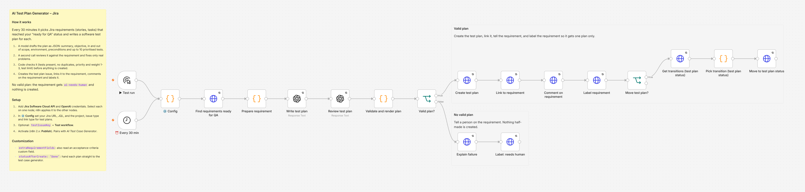

# AI Test Plan Generator – Jira

Turns Jira requirements that are ready for QA into a software test plan (STP) issue: scope, environment, preconditions and up to 10 prioritised tests, reviewed by a second model call and checked by code before anything is created.

## What it does

Every 30 minutes it picks up to 3 requirement tickets (stories, tasks) that reached your "ready for QA" status and haven't had a plan yet. For each one:

1. **Draft.** A model writes the plan as JSON: feature name, summary, objective, in scope, out of scope, test environment, preconditions, and a list of tests with priority and weight (1-3).
2. **Review.** A second model call compares the draft with the requirement and fixes only real problems: a missing major flow, a test that contradicts the requirement, broken JSON.
3. **Check with code.** At least one test, no duplicates, priority and weight are integers 1-3, at most `maxTests` tests. If the review step returned broken JSON, the checked draft is used instead.
4. **Create.** A test plan issue in your QA project, written as Jira tables (Description, Test Coverage and Traceability, Exit Criteria), linked to the requirement and labelled `ai-test-plan`.
5. **Report back.** A comment on the requirement with a link to the plan, and the `ai-test-plan-created` label so each requirement gets one plan.

If neither model answer is a valid plan, nothing is created: the requirement gets a comment and the `ai-needs-human` label.

The plan's coverage table is the input for [AI Test Case Generator – Jira + Xray](../ai-test-case-generator-xray/).

## What it replaced

In production this workflow produced about **40 test plans a month**. Each one took a QA engineer about **2 hours** to write by hand from the requirement.

**Hours saved: about 80 hours a month** (40 × 2 h).

This version is generalised from that production workflow. The original also waited for a second workflow to copy the requirement into a custom field; this one reads the requirement ticket directly, so there is no polling and no custom field to create.

## Setup

### You need

- n8n with built-in nodes only. Built and tested on n8n 2.35.7.
- Jira Cloud and a Jira API token for a user who can browse both projects, create issues, link issues, add comments and edit issues.
- An OpenAI API key.
- An issue type for test plans. With Xray use `Test Plan`; without Xray any type works, for example `Task`.

### Steps

Shortcut: create the credentials before you import and name them exactly `Jira Cloud account` and `OpenAI account`. n8n then links them to every node when you save the imported workflow.

1. **Import.** In n8n, create a new workflow, then **⋯ → Import from File** and pick `ai-test-plan-generator.json`.
2. **Jira credential.** Create an API token at <https://id.atlassian.com/manage-profile/security/api-tokens>. Open **Find requirements ready for QA**, create a *Jira Software Cloud API* credential (Email, API Token, Domain `https://your-company.atlassian.net`). n8n applies it to every other Jira node.
3. **OpenAI credential.** Open **Write test plan** and create an *OpenAI* credential. n8n applies it to **Review test plan**.
4. **Settings.** Edit **⚙️ Config** (table below).
5. **Test on one ticket.** Set `const testIssueKey = 'DEV-123';`, click **Test workflow**, and check Jira: a new test plan with three tables, a link to the requirement, a comment and a label on the requirement. Set `testIssueKey` back to `''`.
6. **Turn it on.** Activate the workflow (n8n 2.x: **Publish**). Optional: **Settings → Error workflow → [Error Handler – Alert On Failed Workflows](../error-handler-alert-on-failure/)**.

### ⚙️ Config

| Key | What to set | Default |
|---|---|---|
| `jiraBaseUrl` | Your Jira Cloud site; must match the credential's Domain | `https://your-company.atlassian.net` |
| `jql` | Requirements ready for a plan. Keep the label filter | `project = DEV AND issuetype in (Story, Task) AND status = "Ready for QA" AND (labels is EMPTY OR labels not in (ai-test-plan-created, ai-needs-human)) ORDER BY updated ASC` |
| `maxIssuesPerRun` | Requirements per run | `3` |
| `extraRequirementFields` | Custom fields read together with the description, for example `['customfield_10050']` for acceptance criteria | `[]` |
| `testPlan.projectKey` | Project where test plans are created | `QA` |
| `testPlan.issueType` | Issue type of the plan | `Test Plan` |
| `testPlan.summaryPrefix` | Text before the requirement's summary | `Test Plan: ` |
| `testPlan.linkType` | Link type between plan and requirement | `Relates` |
| `testPlan.copyAssignee` | Assign the plan to the requirement's assignee | `true` |
| `testPlan.statusAfterCreate` | Move the new plan to this status. `'Done'` hands it straight to the test case generator; `''` leaves it for a person to review | `''` |
| `labels.requirementDone` | Label on the requirement | `ai-test-plan-created` |
| `labels.testPlan` | Label on the created plan | `ai-test-plan` |
| `labels.needsHuman` | Label when no valid plan came back | `ai-needs-human` |
| `maxTests` | Most tests per plan | `10` |
| `exitCriteria` | Lines in the Exit Criteria section | two lines |
| `model` | OpenAI model id | `gpt-5.5` |
| `testIssueKey` | One requirement for a manual test run | `''` |

## Behaviour and limits

- Two model calls per requirement.
- Plans use only what the requirement says. Missing details appear as short lines starting with `Assumption:`, so a reviewer can spot them.
- To get a new plan for a requirement, remove its `ai-test-plan-created` label.
