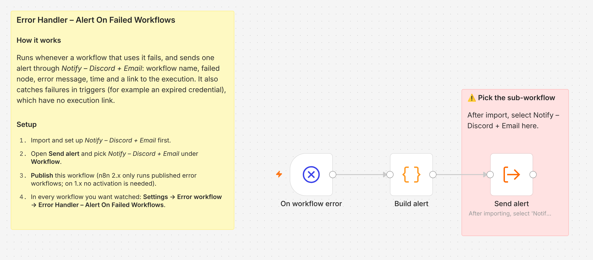

# Error Handler – Alert On Failed Workflows

Sends one alert to Discord and email whenever a workflow that uses it fails, with the details needed to act on it.



## What it does

- Starts from n8n's **Error Trigger** when a watched workflow fails.
- Builds an alert with the workflow name, the node that failed, the error message, the time (UTC), the run mode and a link to the failed execution.
- Also handles failures inside a trigger (for example an expired credential on a schedule), which have no execution link. The alert says so.
- Escapes the error text in the email, so an error that contains HTML can't break or inject into the message.
- Sends the alert through [Notify – Discord + Email](../notify-discord-email/).

## What it replaced

Checking the executions list by hand to find failed runs. No hours figure: its value is that a failure is seen within a minute, not when someone notices missing Jira updates.

## Setup

1. Import and set up [Notify – Discord + Email](../notify-discord-email/) first, and publish it.
2. **Import.** In n8n, create a new workflow, then **⋯ → Import from File** and pick `error-handler-alert-on-failure.json`.
3. **Link the sub-workflow.** Open **Send alert** and choose *Notify – Discord + Email* under **Workflow**. The red note on the canvas marks this step; the reference in the file points to no workflow on your instance.
4. **Publish it.** n8n 2.x only runs published error workflows. On n8n 1.x no activation is needed.
5. **Watch your workflows.** In each workflow: **⋯ → Settings → Error workflow → Error Handler – Alert On Failed Workflows** → Save.
6. **Test.** Make a watched workflow fail once (for example, set a wrong status name in its ⚙️ Config and run it). You should get one Discord message and one email.

The alert format:

```
❌ n8n: AI Bug Triage – Escalate To Dev failed
Workflow: AI Bug Triage – Escalate To Dev
Failed node: Move to dev status
Error: Can't move BUG-42 to "Ready for Dev": not reachable from its current status (reachable: In Progress). Check the status name in ⚙️ Config.
When: 2026-11-05 09:14:03 UTC (trigger)
Execution: https://your-n8n/workflow/…/executions/231
```
