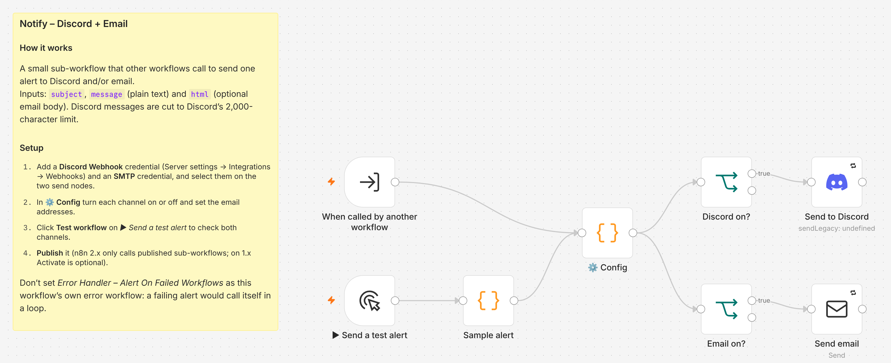

# Notify – Discord + Email

A small sub-workflow that any other workflow calls to send one alert to Discord and/or email. [Error Handler – Alert On Failed Workflows](../error-handler-alert-on-failure/) uses it.

## What it does

- Takes three inputs: `subject`, `message` (plain text) and `html` (optional email body; built from `message` when empty, with HTML escaped).
- Sends the message to a Discord channel through a webhook, cut to Discord's 2,000-character limit.
- Sends the email through your SMTP server.
- Each channel can be switched off in **⚙️ Config**.
- Retries each send up to 3 times.

## What it replaced

Each workflow used to carry its own Discord and email nodes. Now one place holds the channels and addresses, and every workflow calls it. No hours figure: it removes duplicated setup rather than manual work.

## Setup

### You need

- A Discord channel webhook (Server settings → Integrations → Webhooks → New Webhook → Copy Webhook URL), and/or
- An SMTP account (host, port, user, password).

### Steps

1. **Import.** In n8n, create a new workflow, then **⋯ → Import from File** and pick `notify-discord-email.json`.
2. **Discord credential.** Open **Send to Discord**, create a *Discord Webhook* credential and paste the webhook URL.
3. **SMTP credential.** Open **Send email** and create an *SMTP* credential.
4. **Settings.** Edit **⚙️ Config** (table below).
5. **Test.** Click **Test workflow** with **▶ Send a test alert** selected. The message "Test alert from n8n" should reach both channels.
6. **Publish it.** n8n 2.x only calls published sub-workflows. On n8n 1.x, activation is optional.

### ⚙️ Config

| Key | What to set | Default |
|---|---|---|
| `sendDiscord` | Send to Discord | `true` |
| `sendEmail` | Send email | `true` |
| `emailFrom` | Sender address your SMTP server accepts | `n8n@your-company.com` |
| `emailTo` | Recipients, comma-separated | `qa-alerts@your-company.com` |

### Call it from another workflow

Add an **Execute Workflow** node, choose this workflow, and map `subject`, `message` and, if you want, `html`.

Don't set *Error Handler – Alert On Failed Workflows* as this workflow's own error workflow: a failing alert would call itself in a loop.
